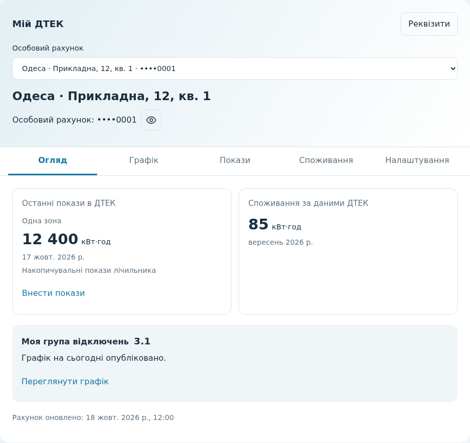
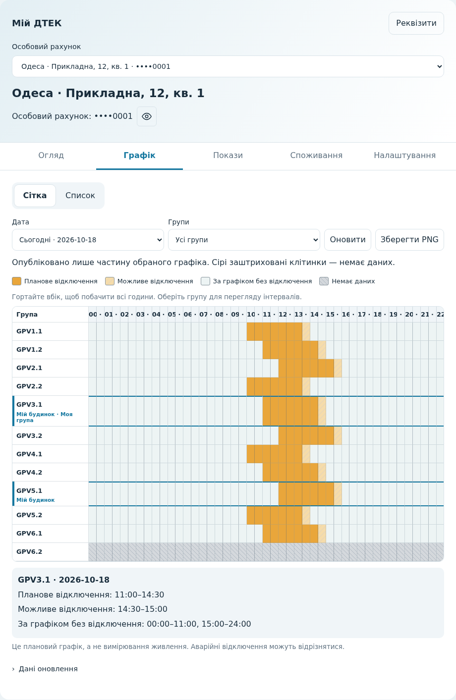
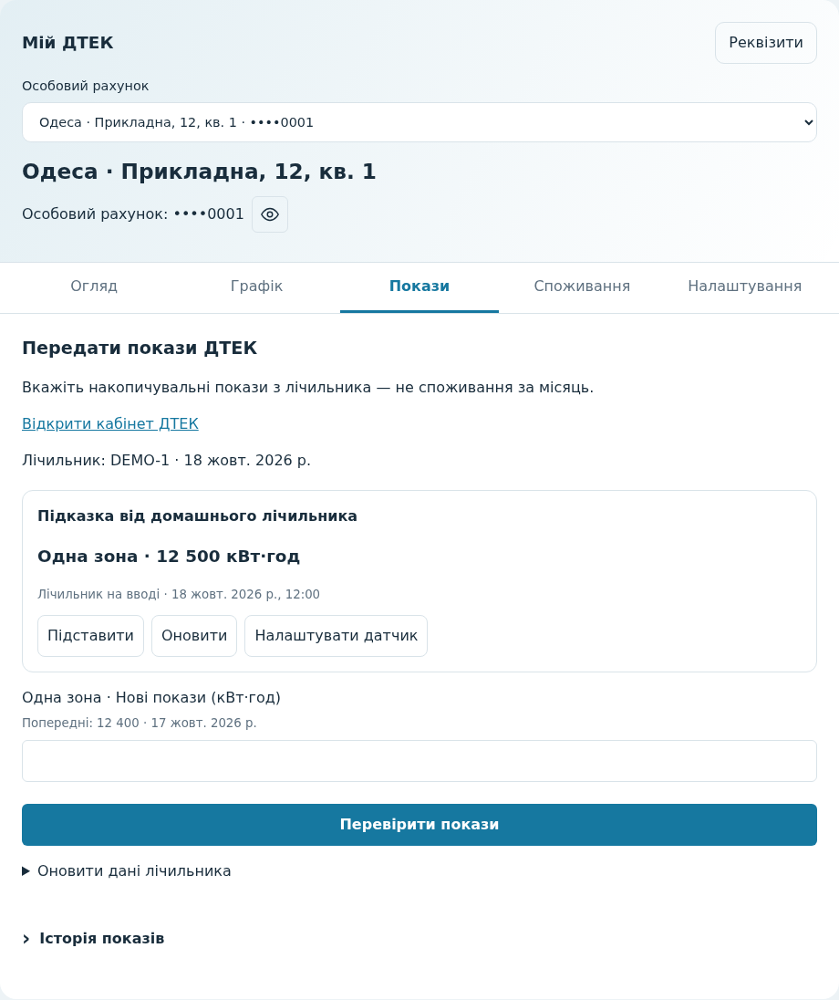
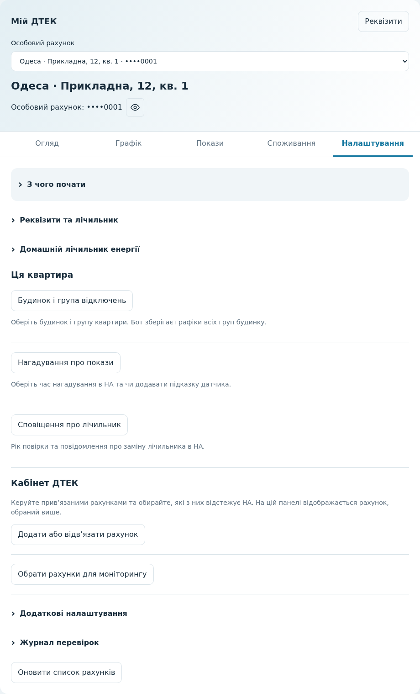

# Попередня версія особистого кабінету

[English](PERSONAL_ACCOUNT_PREVIEW.md) · **Українська**

Гілка `feature/personal-account` додає необов'язкове підключення особистого
кабінету ДТЕК з читанням даних і ручною передачею показів. Це експериментальна версія (`1.8.0b19`), наразі
для **побутових рахунків ДТЕК Одеські електромережі**. Адресний моніторинг
продовжує підтримувати всіх операторів, перелічених у головному README.

## Як спробувати

Використовуйте окремий тестовий Home Assistant. Скопіюйте каталог
`custom_components/dtek_monitor` із цієї гілки до каталогу конфігурації та
перезапустіть Home Assistant. Не встановлюйте другу копію інтеграції під іншою
назвою каталогу.

Ця версія оновлює записи конфігурації до версії 4. Перед перевіркою на наявній
інсталяції створіть резервну копію конфігурації. Для повернення до версії 1.7.0
потрібно відновити попередню конфігурацію з резервної копії разом із кодом.

1. Відкрийте **Налаштування → Пристрої та служби → Додати інтеграцію → DTEK Monitor**.
2. Оберіть **ДТЕК Одеські електромережі**.
3. Оберіть **Особистий кабінет і покази**. Для графіків без авторизації натомість оберіть
   **Графіки за адресою**.
4. Оберіть **Увійти**, **Створити кабінет ДТЕК** або **Забули пароль?**. Для входу
   введіть телефон і пароль, які використовуєте на сайті ДТЕК.
5. Оберіть потрібні побутові особові рахунки.
6. Відкрийте пристрої, створені в новому підключенні особистого кабінету.

Home Assistant зберігає дані входу у своїй конфігурації; захищайте конфігурацію
та резервні копії. Cookies і токени API зберігаються в пам'яті. Якщо авторизація
закінчиться, пройдіть повторний вхід через Home Assistant до того самого
облікового запису ДТЕК.

## Панель «Мій ДТЕК»

Екран завершення підключення пояснює наступні дії. Завершіть налаштування,
оновіть сторінку HA, відкрийте панель → **Редагувати панель → Додати картку**
та знайдіть **My DTEK**. Оберіть рахунок у візуальному редакторі й збережіть.
Інтеграція завантажує картки автоматично: вручну реєструвати ресурси не потрібно.
Попередні окремі картки залишаються доступними.

Якщо кабінет порожній, спочатку відкрийте **Налаштування → Пристрої та служби →
DTEK Monitor → Налаштувати**, щоб додати або обрати рахунки. Повторний вхід не потрібен.

Кабінетом і ручною передачею показів можна користуватися **без домашнього датчика
енергії**. Для підказок датчика відкрийте **Мій ДТЕК → Налаштування → Домашній
лічильник енергії**. Розділ **З чого почати** пояснює вибір рахунків, опорні покази
та групи будинку. Він розгортається за бажанням і не змінює налаштувань.

Необов’язковий відповідник у YAML:

```yaml
type: custom:dtek-account-workspace-card
entity: sensor.example_account_data_updated
show_account_selector: false
```

Оберіть свій рахунок у візуальному редакторі. Без початкового вибору єдиний
підключений рахунок відкриється автоматично; за наявності кількох потрібно обрати
потрібний. Увімкніть перемикач рахунків для перегляду в межах однієї картки.
Для окремих панелей квартир задайте рахунок кожній картці та вимкніть перемикач.
Глобального активного рахунку немає.

- **Огляд:** адреса, останні накопичувальні покази, окремо позначене місячне
  споживання та стан особистого графіка. **Внести покази** розташовано під
  останніми показами, **Переглянути графік** — у блоці групи.
- **Графік:** своя група або всі групи будинку. Вибір відображення не змінює
  календарів будинку, які використовує Telegram-бот.
- **Покази:** ручне введення або явне підставлення підказки датчика, перевірка,
  підтвердження, результат передачі та розгортання історії показів.
- **Споживання:** місячне споживання й порівняння без повторного списку показів.
- **Налаштування:** реквізити, EIC і лічильник, налаштування датчика, посилання
  на параметри інтеграції та необов’язковий журнал локальних перевірок.

Вкладки зберігають незавершене введення. При зміні рахунку картка запитує, чи
скасувати зміни; під час передачі перемикання заблоковане. Оновлення HA не
підставляють нових показів датчика в редаговану форму. Користувачі без права
передачі бачать історію без форми надсилання.

### Приклади інтерфейсу

На знімках використано вигадані рахунки й покази.



<details>
<summary>Графік, покази та налаштування</summary>







</details>

## Налаштування квартири та кабінету

У **Мій ДТЕК → Налаштування** оберіть потрібну дію:

- **Будинок і група відключень** відкриває вибір будинку та групи для квартири,
  зазначеної вгорі панелі. Календарі будинку й Telegram-бот зберігають усі групи
  будинку.
- **Нагадування про покази** визначає час нагадування та додавання підказки датчика
  для цього рахунку. **Сповіщення про лічильник** керує повідомленнями про повірку
  та заміну. Обидва типи повідомлень з’являються в Home Assistant.
- У розділі **Кабінет ДТЕК** дія **Додати або відв’язати рахунок** керує прив’язками
  в кабінеті. **Обрати рахунки для моніторингу** визначає, які рахунки завантажує HA.
  Ці дії стосуються кабінету, а не лише квартири на панелі.
- **Додаткові налаштування → Перевірки показів за розкладом** налаштовує локальні
  перевірки без передачі показів.

Форми відкриваються поверх панелі та зберігають введені дані під час оновлень HA.
Саме відкриття форми нічого не зберігає. Якщо введення показів або налаштування
датчика не завершене, спочатку оберіть продовження редагування або явно скасуйте
чернетку. Закриття зміненої форми налаштувань також потребує підтвердження.
Якщо відповідь на збереження втрачено, запит не повторюється автоматично:
закрийте форму та перевірте налаштування перед новою спробою.

Вибір рахунку в картці змінює лише цю картку. Вибір моніторингу визначає, які
сутності завантажує HA: зняття вибору прибирає сутності рахунку, але зберігає
прив’язку в кабінеті ДТЕК та локальні опорні покази датчика. Відв’язування від
кабінету — окрема дія з підтвердженням. Для цих налаштувань потрібні права
адміністратора HA. Якщо форма не відкривається, резервне посилання відкриває
налаштування інтеграції окремо.

## Налаштування домашнього датчика енергії

Відкрийте **Налаштування → Домашній лічильник енергії** у «Мій ДТЕК».
Підключення й звірка залишаються в цій вкладці; у **Показах** є лише підказка та
явна кнопка **Підставити**. **Налаштувати датчик** повертає до того самого блоку
налаштувань. Відкриття блоку читає конфігурацію й не передає показів у ДТЕК.

- Для підключення натисніть **Прив’язати датчик енергії**. Оберіть накопичувальний
  датчик для кожної тарифної зони. Розрахунок за додатковим лічильником потребує
  свіжих показів основного; прямий режим підходить для читання самого основного.
- **Додаткові налаштування** містять перевірку свіжості, максимальний вік даних
  та правдоподібну вхідну потужність. При заміні прив’язки попередні значення
  зберігаються. У прямому режимі опорна пара не потрібна.
- **Звірити з основним лічильником** зіставляє введені фактичні покази з поточним
  відліком датчика. Перевірте пару та час, а потім явно підтвердьте збереження.
  Змінюється лише локальна прив’язка.
- Відомості та історія прив’язки, а також її видалення розгортаються окремо.
  Наявну прив’язку можна звірити без доступу до ДТЕК; для нової потрібні доступні
  дані основного лічильника. Після відновлення зв’язку скористайтеся блоком
  **Оновлення даних лічильника ДТЕК**.

Оновлення HA та переходи між вкладками зберігають незавершені поля датчика.
Для зміни рахунку потрібно підтвердити скасування редагування; незавершена
операція блокує перемикання. Збереження або видалення прив’язки залишає введені
покази, але робить підказку від попередньої прив’язки недійсною. Підставте свіжу
підказку або перевірте й відредагуйте значення вручну перед переглядом передачі.
У межах цієї картки локальна звірка та передача показів не виконуються одночасно.

## Сітка графіків

Вкладка **Графік** відкриває сітку з кроком 30 хвилин для всіх опублікованих груп
обраного оператора. Групи будинку мають рамку й позначку **Мій будинок**;
підтверджена особиста група — також **Моя група**. Натисніть рядок, щоб побачити
точні інтервали під сіткою. Відображення не змінює групи будинку, особистий вибір,
календарі чи сповіщення Telegram.

Перемикач **Сітка / Список** обирає формат. У сітці оберіть сьогодні або один із
наступних шести днів, а в полі **Групи** — **Мій будинок** або **Усі групи**.
У **Списку** оберіть **Моя група** чи **Мій будинок · усі групи**. Кожен календар
зберігає власну навігацію; повернення до сітки зберігає дату, фільтр і прокручування.
Ці перемикачі не змінюють групу квартири. На телефоні гортайте сітку
горизонтально: підписи груп залишаються видимими. Дати й години відповідають
Europe/Kyiv, включно з повторенням або пропуском години під час переведення годинників.

Легенда розрізняє планове та можливе відключення, час без відключення за графіком,
тижневий прогноз і відсутність даних. Біла клітинка не підтверджує фактичну
наявність світла. Відсутня, прихована або помилкова публікація не перетворюється
на порожній графік. Для неопублікованих дат клітинки невідомі; після помилки
зв’язку попередня сітка приховується. Пояснення над сіткою стосується обраної дати
й видимих груп. Легенда показує лише наявні типи клітинок; час оновлення джерела
й перевірки можна розгорнути в **Дані оновлення**. Сітка читає локальні дані HA
без додаткових запитів до ДТЕК.

**Зберегти PNG** експортує обрану дату й видимі групи з виділенням будинку,
легендою та часом оновлення. На зображенні є адреса будинку, але немає номера
квартири чи особового рахунку. Файл є знімком і не оновлюється. Завантаження
недоступне під час отримання даних або коли всі видимі клітинки невідомі.
Звичайні оновлення HA не скидають обрану дату та фільтр.

Окрема `custom:dtek-schedule-card` теж відкриває сітку за замовчуванням;
`view: list` зберігає попередній початковий вигляд. Її `status_entity`, календар
планових і календар можливих відключень мають бути ввімкнені й доступні користувачу HA.

## Реєстрація та відновлення через SMS

Обидва сценарії доступні в майстрі HA після вибору особистого кабінету.
Відкриття форми нічого не надсилає. Після введення телефону та натискання
«Далі» ДТЕК надсилає SMS із чотиризначним кодом. Початкові нулі коду потрібно
зберегти. Повторне SMS надсилається лише за вашим запитом, щонайменше через
60 секунд; ДТЕК може встановити довше обмеження.

- **Реєстрація:** телефон → SMS → ім’я → новий пароль та згода на обробку
  персональних даних. Створення кабінету відбувається лише на останньому кроці.
- **Відновлення:** телефон → SMS → новий пароль та явне підтвердження його зміни.
  Перевірка коду не змінює пароль. Можна скасувати останній крок і залишити
  чинний пароль. Після успішної зміни HA виконає вхід з новим паролем та оновить
  відповідне підключення, якщо воно вже існує.

Пароль має містити 8–64 символи: щонайменше дві великі літери, одну малу та
одну цифру, без пробілів. SMS-коди й ідентифікатори сеансів не зберігаються
в конфігурації. Сеанс налаштування SMS закривається після 15 хвилин бездіяльності.
Якщо відповідь після зміни пароля загубилася, HA не повторює запит: спробуйте
увійти з новим паролем або скористайтеся офіційним відновленням доступу.

## Керування особовими рахунками

Після входу оберіть наявні рахунки для моніторингу або **Додати рахунок до ДТЕК**.
Новий кабінет може бути порожнім: додайте рахунок одразу або завершіть підключення
й поверніться пізніше через **Налаштувати → Особові рахунки в кабінеті ДТЕК**.
Поки рахунки не обрано для моніторингу, датчики не створюються.

Це три незалежні налаштування:

- **Прив’язки ДТЕК:** додати або відв’язати рахунок у кабінеті оператора.
- **Моніторинг HA:** обрати прив’язані рахунки, для яких потрібні пристрої, датчики й календарі.
- **Відображення:** обрати рахунок на кожній картці; різні панелі можуть показувати різні рахунки.

Для додавання введіть сучасний 12-значний побутовий номер, який починається з `572`.
HA знайде адресу: перевірте повний номер і адресу та підтвердьте дію. Лише після
підтвердження надсилається запит прив’язки. Далі окремо оберіть, чи потрібно
відстежувати рахунок у HA. Старі формати номерів і бізнес-рахунки поки керуються
через сайт ДТЕК.

Для відв’язування спочатку зніміть позначку рахунку в **Вибрати особові рахунки**,
збережіть зміни й дочекайтеся перезавантаження підключення. Потім відкрийте
**Особові рахунки в кабінеті ДТЕК → Відв’язати від кабінету ДТЕК**, оберіть рахунок і
підтвердьте адресу. Це прибирає рахунок із кабінету, але не розриває договір
електропостачання. Рахунок, який відстежує інше підключення HA, тут відв’язати не можна.

Можна зняти всі позначки: авторизоване підключення залишиться для керування
рахунками. Це не змінює прив’язок у ДТЕК. Опорні покази джерел енергії та журнали
передач зберігаються, а сутності знятих із моніторингу рахунків видаляються.
Незалежний моніторинг будинку продовжує працювати.

Підтвердження діє п’ять хвилин. Невдалий або невизначений запит прив’язки чи
відв’язування не повторюється автоматично. Якщо результат невідомий, перевірте
список рахунків у кабінеті ДТЕК перед новою спробою.

Офіційні [реєстрація](https://auth.my.dtek-oem.com.ua/signup) та
[відновлення доступу](https://auth.my.dtek-oem.com.ua/recovery) залишаються
доступними, якщо ДТЕК змінить API. Ця попередня версія використовує запити
офіційного вебінтерфейсу, а не документований публічний API.

Для локальної демонстрації з вигаданими даними запустіть у каталозі репозиторію
`python -m http.server 8974 --bind 127.0.0.1` та відкрийте
`http://127.0.0.1:8974/examples/account-workspace/`. Екрани підключення є макетом;
панель використовує справжні картки з імітованими відповідями. SMS і покази до
ДТЕК не надсилаються.

## Доступні дані

- Враховані покази лічильника та їхні дати, окремо для кожної повернутої тарифної
  шкали. Використовуються незаблоковані **попередні** покази ДТЕК, а не введені
  дані, що очікують обробки.
- Споживання за останній доступний закритий місяць з атрибутом `period`.
- Модель лічильника та рік наступної повірки.
- Час успішного отримання даних кабінету.

Оновлення відбувається кожні шість годин. Це розрахункові дані, а не вимірювання
наявності світла в реальному часі. Новий запит не означає нових показів.
Відсутні дані залишаються невідомими; недоступний рахунок не показує нульове
споживання.

Місячні коригування можуть бути від'ємними. Історичні дані поки не передаються
до панелі «Енергія»: у сенсорів навмисно немає статистичного `state_class`.
Імпорт статистики потребує окремої реалізації з урахуванням дат періодів і
перерахунків минулих значень.

Спочатку підтримується один лічильник на побутовий рахунок. Тарифні шкали
зберігаються окремо; наживо перевірено лише однозонний випадок в Одесі.
Бізнес-рахунки та кабінети інших регіонів поки не ввімкнені.

## Кілька рахунків і панелі

До одного входу за телефоном може бути прив’язано кілька особових рахунків.
**Налаштувати → Вибрати особові рахунки** визначає, які з них відстежує HA.
Кожен обраний рахунок має окремий пристрій HA, покази, календарі, прив’язку джерела
енергії, опорні значення, нагадування та розклад перевірок. Додавання другого
рахунку не копіює датчик чи калібрування першого. Прив’яжіть накопичувальний
датчик споживання з міської мережі саме потрібної квартири.

Видимість на панелі налаштовується окремо:

- Щоб відстежувати два рахунки, а показувати один, залиште обидва в інтеграції
  та додайте на панель картки потрібного рахунку.
- Щоб бачити обидва поруч, додайте окремий набір карток для кожного.
- Для двох панелей або вкладок оберіть відповідний рахунок у кожній картці.

Візуальні редактори карток номера рахунку, історії, передачі показів та журналу
перевірок мають список **Особовий рахунок** із прихованим номером та адресою.
Спільного «активного рахунку» немає. Зміна однієї картки не перемикає інші картки
та не змінює перелік рахунків інтеграції. Недоступний рахунок залишається обраним,
доки ви самі не зміните вибір; автоматичної підміни першим рахунком немає.
Після додавання рахунків у налаштуваннях натисніть **Оновити список рахунків**.
Список містить лише підключені рахунки, доступні вашому користувачу HA. Інші
додаються у формі інтеграції **Вибрати особові рахунки**.

Наявний YAML працює без змін: `entity` може посилатися на будь-яку ввімкнену
сутність потрібного рахунку. Пристрої HA можна перейменувати для зручності.
Приховування картки чи панелі не скасовує доступ до сутностей; за це відповідають
права користувачів HA.

## Група квартири та графіки будинку

Авторизація в кабінеті не визначає групу квартири: перевірені відповіді кабінету
зараз не містять такої прив’язки. У будинку може бути кілька груп. **Основна група
графіка** — значення для сумісності, а не визначення групи вашої квартири.

1. Через **Налаштувати → Додати моніторинг будинку** завершіть налаштування адреси
   або використайте вже додану адресу того самого оператора.
2. Відкрийте **Налаштувати → Моя група та графік**, оберіть рахунок і перевірте будинок.
3. Єдина підтверджена група будинку прив’язується автоматично. Якщо груп кілька,
   оберіть перевірені групи квартири. Вибір можна змінити пізніше. Порожній список
   повертає автоматичний режим: він працює лише для рівно однієї групи будинку.

У пристрої рахунку з’являться **Моя група**, **Стан мого графіка**,
**Мій графік відключень** та **Мій графік можливих відключень**. Додайте особисті
календарі на панель квартири. Загальні календарі будинку й Telegram-бот зберігають
усі групи; різні квартири одного будинку можуть мати різний вибір.

Стан відрізняє ручний вибір від автоматичного використання єдиної групи будинку.
Це не прив’язка квартири, отримана з кабінету. Якщо в автоматичному режимі
з’явиться друга група, тільки особистий календар очікує вибору; календарі будинку
та бот продовжують використовувати всі групи. Якщо обрана вручну група зникне з підтверджених груп
будинку, ДТЕК приховає назви груп, адресу буде видалено або перевірка графіка
завершиться помилкою, особисті календарі стануть недоступними. Збережений ручний вибір
залишиться для перевірки; інша група замість нього не підставляється. Причина відображається в
стані графіка. «—» у виборі будинку видаляє лише особисту прив’язку.

## Змінити рахунки та оновити дані

У підключенні кабінету оберіть **Налаштувати → Вибрати особові рахунки**.
Список завантажується під час відкриття форми та не змінюється, поки ви її
редагуєте. Залиште щонайменше один рахунок. Збереження перезавантажує лише це
підключення. Сутності та пристрої, що належать лише знятим з вибору рахункам,
прибираються; автоматизації з цими сутностями потребуватимуть оновлення.
Прив'язки рахунків на сайті ДТЕК не змінюються.

Кожен пристрій рахунку має кнопку **Оновити всі рахунки**. Вона оновлює всі
обрані рахунки цього підключення. Спільне обмеження — 60 секунд після будь-якої
спроби оновлення, включно з автоматичними та невдалими. У разі збою відповідні
сенсори недоступні, а успішно оновлені рахунки залишаються доступними.
Час отримання даних відрізняється від дати врахованих показів.

## Профіль рахунку: адреса, EIC і лічильник

Оберіть **DTEK account profile** у списку карток для окремого профілю або
відкрийте **Реквізити та лічильник** на панелі «Мій ДТЕК». Візуальний редактор обирає один підключений рахунок незалежно від
інших карток. Приклад ручного налаштування:

```yaml
type: custom:dtek-account-profile-card
entity: sensor.example_account_data_updated
```

Повна адреса, включно з квартирою, якщо ДТЕК її надає, видима постійно.
Картка показує модель лічильника, тарифну схему, договірну потужність і рік наступної
повірки. Розгорніть **Відомості про лічильник**, щоб побачити рік виготовлення,
дати встановлення та повірки, відомості про договір, пломби й кількість записів
про заміну. Подробиці непорожньої історії замін поки слід дивитися в кабінеті:
перевіреного прикладу структури цих записів ще немає.

**EIC позначає точку розподілу**, а не номер лічильника, рахунку чи групу відключень.
Збережено всі EIC рахунку; EIC поточної установки позначено окремо. Визначати групу
відключень квартири за цими кодами інтеграція не намагається.

Номери рахунку, EIC, лічильника та пломб спочатку замасковані. Їх можна явно показати
та скопіювати або приховати перед знімком екрана. Адреса залишається видимою:
перевірте її перед публікацією. Маскування — зручність відображення; доступ захищають
права читання HA. Повні номери не додаються до назв сутностей чи історії сенсорів.
Доступ до профілю потребує тих самих прав читання всього рахунку, що й історія.

Профіль використовує наявне оновлення кабінету раз на шість годин. **Оновити** читає кеш HA; для нового запиту до ДТЕК використовуйте кнопку оновлення
на пристрої рахунку. Відсутні поля позначено **Не надано**, а не нулем. Збій запиту
відомостей про лічильник не відкидає коректні покази; за загального збою оновлення
збережені дані показано з їхньою датою. Перегляд профілю не залежить від можливості
чи дозволу передавати покази.

### Перевірка появи показів у кабінеті

**Перевірити, чи є ці покази в ДТЕК**, біля результату передачі в картці
показів, виконує новий запит із обмеженням частоти. Якщо цей HA
має запис передачі, перевірка зіставляє всі передані тарифні шкали із записами
активної енергії за ту саму дату показів у Києві. Результат розрізняє повний збіг,
частковий збіг, кілька можливих записів і відсутність збігу. В окремій історії показів збережено
джерело та статус ДТЕК: активний, неактивний або заблокований. Відсутність збігу
не доводить відмову: дані можуть з’явитися пізніше або мати іншу дату показів.

Збіг підтверджує наявність відповідного запису рахунку, **але не доводить, що саме цей
запит його створив або що місячний розрахунок остаточний**. Старі записи не містять
ідентифікатора свого лічильника. Відому зміну лічильника після передачі показано
окремо. Перевірка не повторює передачу, не змінює калібрування та не знімає блокування
невизначеної доставки. Якщо журналу передач цього HA немає, записи кабінету
можна переглянути в історії показів. Профіль їх не дублює.

### Необов’язкові сповіщення про лічильник

Відкрийте **Налаштувати → Повірка та заміна лічильника**, оберіть рахунок і ввімкніть
потрібні сповіщення. Обидва вимкнені за замовчуванням та незалежні від нагадувань
про покази. Це локальні сповіщення для користувачів цього HA із замаскованим номером
рахунку; приватні дані не надсилаються до бота будинку.

- **Повірка:** одне повідомлення у вказаному році й далі раз на календарний рік,
  доки ДТЕК не оновить відомості. Рік не визначає точної дати чи прострочення;
  уточніть їх в оператора.
- **Зміна номера лічильника:** перше успішне спостереження задає початковий номер,
  подальші зміни виявляються й після перезапуску. Відсутні відомості не скидають
  початковий номер. Це може бути заміна або виправлення даних кабінету. Перевірте
  новий лічильник і явно задайте нові опорні покази: прив’язка автоматично не переноситься.

Перевірка використовує шестигодинне оновлення профілю. Закриття повідомлення
зберігається після перезапуску. Вимкнення прибирає повідомлення; повторне ввімкнення
повірки може знову показати нагадування за поточний рік. Зміни, побачені при вимкнених
сповіщеннях про заміну, задають новий початковий номер без накопичення повідомлень.

## Історія та місячний графік

Картка **DTEK account history**, що входить до інтеграції, показує історію показів
та місячне споживання за обраний рік. Кожна картка належить одному рахунку.
Вона використовує сеанс Home Assistant і потребує дозволу на читання обраної
сутності та всіх сенсорів цього рахунку. Пароль ДТЕК і токени API не передаються браузеру.

Оберіть **DTEK account history** у списку карток та вкажіть потрібний рахунок.
Модуль завантажується автоматично. Для ручного налаштування замініть сутність
нижче на **Оновлення даних кабінету** відповідного пристрою рахунку.

```yaml
type: custom:dtek-account-history-card
entity: sensor.example_account_data_updated
title: Мій рахунок ДТЕК
```

Оберіть рік у картці. За потреби додайте `year: 2025` до конфігурації, щоб починати
з цього року. Типово використовується поточний рік у Києві. Таблиця місяців під
графіком також показує повернуті значення тарифних зон. Таблиця показів містить
по десять записів на сторінці: дату за Києвом, значення, шкалу, тип енергії,
джерело та статус. **Активний**, **неактивний**, **заблокований** і **невідомо**
відтворюють ознаки ДТЕК; неактивний запис не обов'язково означає відхилені покази.

Графік містить лише закриті місяці. Нуль — отримане значення; пропуск означає,
що даних не отримано. Незакритий місяць позначається окремо. Від'ємні коригування
зберігаються. API не ідентифікує лічильник кожного історичного запису, тому старі
покази не прив'язуються до поточного лічильника, а їхня різниця не використовується
для розрахунку споживання при заміні приладу.

Історія завантажується під час відкриття картки або зміни року. Результат
зберігається в пам'яті до шести годин, щонайбільше 16 комбінацій рахунку та року
на підключення. **Оновити історію** замінює результат, зокрема коригування минулих
місяців; це окрема дія від кнопки пристрою **Оновити всі рахунки**. Повторний запит
для того самого рахунку й року дозволений через 60 секунд. Відповідь ДТЕК про
обмеження запитів призупиняє завантаження історії на п'ять хвилин. У разі помилки
збережений результат явно позначений початковим часом отримання. Перезавантаження
підключення очищає кеш.

Історія не записується в атрибути сенсорів або статистику панелі «Енергія».
Порожній рік позначається явно. Понад 1000 отриманих записів або 20 сторінок API,
неузгоджена пагінація чи некоректні дані дають помилку, а не непомітно скорочену
історію. Старі роки доступні лише за наявності відповідей ДТЕК.

### Порівняння однакових періодів

Оберіть рік і натисніть **Порівняти з попереднім роком**. Картка порівнює офіційне
місячне, річне та сезонне споживання лише за місяці, які закриті й опубліковані
**в обох роках**. Для часткового річного або сезонного підсумку явно перелічено
враховані місяці. Пропуски не стають нулями; від’ємні коригування ДТЕК збережено.
Зима тут — січень, лютий і грудень одного календарного року, а не суцільний сезон
грудень–лютий. Показано дату отримання обох наборів даних.

Це датовані значення **споживання** від ДТЕК, а не накопичувальні покази лічильника
і не оцінка за датчиком HA. Попередній рік завантажується за запитом із тими самими
кешем і обмеженнями частоти, що й решта історії.

## Показати або сховати номер рахунку

У картках історії та передачі є кнопка з оком біля **Особового рахунку**.
Спочатку номер замасковано. **Показати номер рахунку** запитує повне значення
через вашу сесію HA; **Сховати номер рахунку** приховує його перед скриншотом.
Достатньо прав читання всіх сенсорів вибраного рахунку, адміністратор не потрібен.
Для самої передачі показів права адміністратора залишаються обов’язковими.

Це зручність відображення, а не захист паролем. Повний номер не додається до
станів/атрибутів сенсорів, назв пристроїв або сховища браузера. Приховування
очищує відображене значення; перебудова чи закриття картки маскує його знову.
Кнопка не стирає введені покази, не змінює рік чи сторінку історії. Вона керує
лише номером рахунку; адреса та серійний номер лічильника на картці залишаються
видимими.

На панелі зі стандартними картками можна додати компактну картку поруч:

```yaml
type: custom:dtek-account-number-card
entity: sensor.example_account_data_updated
```

Інтеграція завантажує цю картку автоматично.
Ідентифікатори сутностей і замасковані назви пристроїв не змінюються.

## Передача показів

Окрема картка **DTEK meter readings** виконує справжню передачу в ДТЕК лише
після перегляду та явного підтвердження значень. Відкриття картки, завантаження
даних і попередня перевірка нічого не надсилають. Використовуйте фактичні покази
лічильника; не перевіряйте фінальну кнопку вигаданими значеннями.

Оберіть **DTEK meter readings** у списку карток або додайте ручну картку
на приватну панель. Реєструвати ресурси не потрібно:

```yaml
type: custom:dtek-account-readings-card
entity: sensor.example_account_data_updated
title: Передати мої покази
```

1. Увійдіть як активний адміністратор HA з правами читання та керування сутностями
   цього рахунку. Звичайним користувачам історія доступна за попередніми правилами
   читання, але команди передачі недоступні.
2. Натисніть **Завантажити дані лічильника**. Перевірте замаскований номер рахунку,
   повну адресу та серійний номер. Рахунок має залишатися прив’язаним у ДТЕК.
3. Введіть цілі кВт·год для кожної тарифної зони в межах розрядності лічильника.
   Нові значення не можуть бути меншими за попередні.
4. Натисніть **Перевірити покази**. Звірте попередні й нові значення та різницю.
5. Поставте позначку підтвердження і натисніть **Підтвердити та передати в ДТЕК**.

Підтвердження прив’язане до користувача HA та рахунку, діє п’ять хвилин і
використовується один раз. Перед відправленням інтеграція повторно перевіряє
рахунок, лічильник і попередні покази. Зміни потребують нового перегляду.
Звичайні оновлення станів HA не стирають введені значення. Чернетки зберігаються
лише в пам’яті до перезавантаження підключення. Автоматичної передачі чи
передачі за розкладом немає.

Спочатку підтримується один підключений побутовий лічильник споживання з однією
зоною або День/Ніч. Генерація/зелений тариф, кілька лічильників, інші зонні схеми,
поточні/очікувані покази, блокування введення або невідомі параметри потребують
кабінету ДТЕК. Обнулення, заміну лічильника, виправлення та додавання фото також
виконуйте в кабінеті. Дату інтеграція не вигадує: досліджений запит передавання
призначає її на стороні ДТЕК.

[FAQ ДТЕК](https://www.dtek-oem.com.ua/ua/faq) пояснює: покази поза місячним
вікном передачі записуються на дату подання та можуть використовуватися для
розрахункових оцінок споживання. Окремого прапорця «місячні покази» у дослідженому
запиті немає. Інтеграція не перетворює різницю між показами на споживання
закритого місяця.

Сам HTTP-успіх не означає прийняття показів. Картка повідомляє про прийняття лише
за явного підтвердження кожної зони від ДТЕК. Це отримання показів, а не
остаточний розрахунок споживання. Часткові відповіді, збої мережі та нерозпізнані
результати потребують перевірки в кабінеті. POST-запит не повторюється
автоматично, зокрема після помилки авторизації.

Перед відправленням HA атомарно зберігає приватний запис спроби: час, значення
та статус, з хешованим ідентифікатором рахунку. Він переживає перезапуск;
перервана спроба залишається невизначеною. За невідомого чи часткового результату
натисніть **Перевірити стан передачі**, перевірте кожну зону в кабінеті ДТЕК і
лише потім **Дозволити нове введення після перевірки**. Розблокування нічого не
надсилає і не доводить відхилення. Нова передача потребує нового перегляду та
підтвердження; поточні покази ДТЕК можуть надалі блокувати введення. Не видаляйте
локальний запис для повтору невизначеної спроби. Остання спроба зберігається
у `.storage` HA; включайте її до резервної копії та відновлення цієї версії.

Після спроби передачі кеш історії скидається. Відкрита картка історії та сенсори
рахунку потребують своїх окремих команд оновлення; новий запис може з’явитися
в ДТЕК із затримкою. Старі значення не доводять невдалу передачу.
Результати передачі покрито синтетичними тестами. Наживо перевірено одну
передачу фактичних показів однозонного лічильника за дозволом власника: ДТЕК
підтвердив прийняття, а історія містить активний запис на дату передачі.

## Використання датчика енергії Home Assistant

Картка передачі показів містить необов’язкову панель **Джерело енергії Home Assistant**.
Підтримуються зареєстровані накопичувальні датчики (`total` або `total_increasing`)
в Wh, kWh або MWh. Спочатку підключіть пристрій до HA через його інтеграцію;
DTEK Monitor не додає драйвер пристрою. Активний адміністратор HA повинен мати
доступ до рахунку та кожного вибраного джерела.

Оберіть джерело **саме цієї квартири й цього лічильника**. Додатковий прилад має
враховувати ту саму енергію з мережі, що й розрахунковий, включно з усіма
навантаженнями. Не використовуйте датчик іншої квартири, виходу інвертора,
балансу імпорту/експорту або лише частини приладів. Інтеграція не може визначити
неправильне підключення чи непомітний байпас. Добові/місячні лічильники зі
скиданням та енергія, розрахована лише з відліків потужності, не підходять для
цієї першої версії функції.

Доступні два режими:

| Режим | Запропоновані накопичені покази |
| --- | --- |
| Пряме читання розрахункового лічильника | Відповідний регістр лічильника з HA |
| Розрахунок за додатковим лічильником | Опорні основні покази + поточне джерело − опорне джерело |

Наприклад, пара `1000 / 100` дає оцінку `1025`, коли джерело досягає `125`.
Якщо фізичний основний лічильник насправді показує `1030`, збережіть нову пару
`1030 / 125`. За наступних показів джерела `135` оцінка становитиме `1040`.
Попередні 5 кВт·год вже враховані й повторно не додаються. Так виправляється
минуле розходження, а не постійна пропорційна похибка приладу. Повторні
розходження потребують перевірки.

### Свіжість джерела при нульовому споживанні

У перевірці джерела типовий режим **Вимагати свіжі повідомлення** враховує також
повторні повідомлення HA з незмінним значенням. Сонячна генерація та нульове
споживання самі по собі не роблять лічильник застарілим.

Для інтеграцій, що повідомляють тільки зміну лічильника, можна явно обрати
**Довіряти статусу доступності інтеграції**. Інтеграція джерела повинна позначати
втрату зв’язку як `unavailable`. Обмеження віку в цьому режимі не діє; зависле
числове значення визначити неможливо. Недоступність, скидання й неправдоподібні
стрибки блокують підказки в обох режимах. Час останнього повідомлення зберігається
чесно, без підміни поточним часом.

Джерела LocalTuya та Tuya Local працюють через однаковий інтерфейс датчиків енергії
HA. DTEK Monitor не містить драйвера Tuya й не потребує developer-акаунта Tuya.

### Створення прив’язки

1. Завантажте поточний лічильник ДТЕК у картці передачі та перевірте рахунок,
   адресу й серійний номер.
2. У панелі джерела виберіть **Завантажити / оновити джерело**, потім
   **Прив’язати датчик енергії**.
3. Виберіть режим і датчик кожної тарифної зони. День/Ніч потребує двох окремих,
   правильно зіставлених регістрів: сумарне значення не дозволяє відновити
   розподіл за зонами після перерви в даних HA.
4. Оберіть перевірку свіжості, описану вище. Для режиму повідомлень задайте
   максимальний вік даних, а для обох режимів — правдоподібну вхідну потужність. Типові
   значення — 15 хвилин та 30 кВт. Перевірка потужності допускає 1 кВт·год
   на дискретність/затримку звітів; це перевірка аномалій, а не гарантія точності.
5. У режимі розрахунку введіть фізичні основні покази, зняті одночасно з відліком
   джерела. Дробові кВт·год дозволені, роздільник — крапка.
6. Виберіть **Перевірити прив’язку**, звірте покази та час джерела, встановіть
   прапорець підтвердження й натисніть **Зберегти локальну прив’язку**.

Нова/замінена прив’язка перевіряє доступний лічильник у ДТЕК. Якщо кабінет
блокує введення, створіть її пізніше. Наявну опорну пару можна переглядати та
коригувати локально навіть за недоступності ДТЕК.

### Підстановка показів і коригування

**Завантажити / оновити джерело** оновлює підказку без зміни введених показів.
**Підставити запропоновані покази у форму** явно переносить значення. Дробова
частина зберігається в розрахунку; для передачі підставляється лише ціла частина.
Передачу в ДТЕК потрібно окремо переглянути та підтвердити. Підказка джерела
діє три хвилини й перевіряється перед передачею. Редагування підставленого
числа переводить його в ручні покази.

Для виправлення введіть фактичні основні покази в головну форму й натисніть
**Використати введені покази для локальної звірки** або введіть їх у панелі
джерела та виберіть **Перевірити нову опорну пару**. Перевірте пару, час та
коригування, потім підтвердьте локальне збереження. Зафіксоване опорне значення
джерела не змінюється, навіть якщо прилад просунувся під час перегляду.

Збереження опорної пари нічого не передає. Вона зберігається після відхилення,
помилки чи відсутності передачі в ДТЕК. Передача розрахованих показів, своєю
чергою, не пересуває опорну пару й не втрачає дробове споживання. Панель
показує останні 24 зміни прив’язки; кожна тарифна зона має власну пару.

Недоступне джерело не надає підказки в обох режимах. У типовому режимі
повідомлень також блокуються застарілі відліки. Зменшення лічильника,
неправдоподібний приріст, зміна одиниці чи ідентичності пристрою призупиняють
розрахунок. Помічене скидання залишається позначеним після зростання показів
або перезапуску HA. Після перевіреного скидання створіть нову пару; після
зміни пристрою/одиниці замініть прив’язку. У прямому режимі після скидання
потрібна заміна прив’язки. Перерву зв’язку можна перекрити різницею накопичених
відліків, якщо прилад продовжував облік без скидання. Скидання чи споживання
через байпас за вимкненого HA не завжди можна виявити: за сумнівів потрібна
фізична звірка.

Час джерела означає останнє повідомлення HA, включно з незмінним значенням, а не гарантію
свіжого вимірювання в хмарному сервісі. Вибирайте допустимий вік відповідно
до інтервалу звітів пристрою та перевірте його поведінку. Незмінне число може
означати справжню відсутність споживання.

Опорні пари та контроль безперервності зберігаються незалежно від Recorder у
приватному файлі HA `.storage/dtek_monitor.energy.<entry_id>`. Додавайте його
до резервних копій. Помилки збереження вимикають підказки джерела; ручне введення
залишається доступним. Видалення прив’язки видаляє локальну історію коригувань
і не змінює покази в ДТЕК.

Ця версія має підказки та явно підтверджену ручну передачу. Нагадування в HA
можна ввімкнути окремо; автоматична передача не реалізована.
Джерела належать особистим рахункам і не налаштовують будинкового Telegram-бота
або його датчики наявності живлення.

## Картка панелі

Додайте ручну картку на приватну панель. Замініть усі приклади ідентифікаторів
нижче на сутності свого пристрою рахунку. Використовуються лише стандартні
картки Home Assistant. Для інших рахунків скопіюйте картку; для кожної тарифної
шкали за потреби додайте окремі рядки показів та їхньої дати.

```yaml
type: entities
title: Особистий кабінет ДТЕК
show_header_toggle: false
entities:
  - entity: sensor.example_recorded_reading
    name: Враховані покази
  - entity: sensor.example_reading_date
    name: Дата показів
  - entity: sensor.example_latest_closed_month_consumption
    name: Місячне споживання
  - type: attribute
    entity: sensor.example_latest_closed_month_consumption
    attribute: period
    name: Місяць споживання
  - entity: sensor.example_account_data_updated
    name: Дані отримано
  - entity: sensor.example_meter_model
    name: Модель лічильника
  - entity: sensor.example_next_verification_year
    name: Наступна повірка, рік
  - entity: button.example_refresh_all_accounts
    name: Оновити всі рахунки
```

## Перевірки за розкладом без передачі

Відкрийте **Налаштувати → Перевірка показів за розкладом**, оберіть рахунок
і ввімкніть перевірки. Типово вони вимкнені. Задайте час у **Europe/Kyiv**
та періодичність: щодня або щодня у вікні передачі (останні два дні місяця
та перші три дні наступного). Хвилинний таймер виконує перевірку за першої
можливості після заданого часу. Після простою HA перевіряється лише поточний
день; попередні пропущені дні не відтворюються.

Перевірка читає актуальні дані лічильника з ДТЕК і розраховує пропозицію за
прив’язаним накопичувальним датчиком цього рахунку. Перевіряються тарифні зони,
ідентичність лічильника, попередні покази, свіжість джерела, помічене обнулення,
заміна та неправдоподібні стрибки. Невідомий результат попередньої передачі
блокує нову пропозицію. Кожна тарифна зона має власне джерело та значення.
Рахунок без прив’язки повідомляє про її відсутність і не використовує датчик
іншого рахунку.

Запропоноване значення — **накопичувальні покази лічильника для передачі**, а не споживання за місяць. У режимі розрахунку це збережені покази основного лічильника плюс приріст датчика від моменту звірки. Для передачі береться ціла частина кВт·год; дробова частина зберігається в розрахунку. Місячне споживання — різниця показів на межах місяця.

**Нічого не передається в ДТЕК.** Перевірка не створює підтвердження передачі,
не змінює опорну пару та не надсилає повідомлень у Telegram. Автоматична передача
в цій версії недоступна. Готовий результат означає, що розрахунок пройшов
перевірки **на вказаний час**. Звірте фізичний лічильник; передача виконується
через звичайну картку показів з явним підтвердженням і новою перевіркою.

На пристрої рахунку є кнопка **Перевірити покази без передачі** та сенсор
**Перевірка показів**. Кнопка працює з вимкненим розкладом і не замінює планову
перевірку. Між ручними перевірками рахунків одного підключення має минути
60 секунд. Сенсор зберігає останній результат та до 20 перевірок з оригінальними
часовими позначками повідомлень датчиків. Журнал переживає перезапуск.
Перервану планову перевірку позначено відповідно, без повтору того самого дня;
помилка журналу зупиняє перевірки до її усунення.

Для зручного перегляду додайте на панель картку **DTEK reading checks** та оберіть
рахунок. Інтеграція завантажує картку автоматично. На панелі «Мій ДТЕК» журнал
доступний у налаштуваннях. Приклад YAML:

```yaml
type: custom:dtek-account-check-card
entity: sensor.example_account_data_updated
title: Квартира — перевірки показів
```

**Оновити журнал** читає лише збережені локальні результати, не запускає перевірку
та не звертається до ДТЕК. Записи журналу й атрибути сенсора містять розрахунки
та ідентифікатори джерел, тому надавайте доступ до рахунку потрібним користувачам HA.

## Нагадування про покази в Home Assistant

Відкрийте **Налаштувати → Нагадування про покази**, виберіть рахунок і ввімкніть
нагадування. Типово вони вимкнені. Задайте час у **Europe/Kyiv** (типово 19:00)
та вкажіть, чи додавати розрахунок за прив’язаним датчиком енергії.

Одне нагадування з’являється за період у перший доступний день після обраного
часу в межах **останніх двох днів місяця та перших трьох наступного**, відповідно
до [рекомендації ДТЕК Одеса](https://www.dtek-oem.com.ua/ua/news/yak-shvidko-i-prosto-peredati-pokazi-lichilnika-za-svitlo-rozpovidaye-dtek-odeski-elektromerezhi). Короткі місяці, високосні роки та перехід
року враховано. Після простою HA нагадування ще може з’явитися в цьому вікні,
але не після його завершення. Нагадування не фіксує розрахунок чи попередній
показ як остаточне місячне значення.

Це сповіщення у шторці HA, видиме користувачам цього HA, а не приватний push чи
повідомлення в Telegram. Номер рахунку скорочено до останніх чотирьох цифр.
Розрахунок перевіряється за доступністю джерела, скиданнями, поточним лічильником
і прийнятим показом. Якщо підтвердити його неможливо, буде прохання зняти покази
вручну. Нагадування нічого не передає: відкрийте картку показів, звірте значення
та підтвердьте передачу самостійно.

Якщо вже передали покази будь-яким способом, закрийте нагадування. Закриття
зберігається на весь період, включно з перезапусками. Незакрите нагадування
відновлюється в межах вікна; вимкнення налаштування прибирає його. Щоденних
повторів немає. Кнопка **Перевірити нагадування про покази** на пристрої рахунку
працює в будь-який день: вона не вмикає розклад і не замінює планове нагадування.

Для графіків використовуйте [картку графіка](REFERENCE.uk.md#картка-графіка):
вона окремо пояснює підтверджену відсутність планових відключень, відсутність
публікації та помилки запитів для будинку й особистих календарів.

## Додати адресу будинку з кабінету

У підключенні особистого кабінету натисніть **Налаштувати → Додати моніторинг будинку** й оберіть рахунок.
На сторінці інтеграцій у розділі **Виявлено** з'явиться окреме налаштування
адреси. Підтвердьте місто, вулицю і будинок за публічним довідником ДТЕК.
Розпізнані поля підставляються у форми; неоднозначні адреси потрібно обрати
вручну. Номер квартири не переноситься.

Наявна адреса не дублюється. Після створення адресне підключення не залежить від
кабінету: повторна авторизація, видалення або збій кабінету не прибирають
моніторинг будинку.

Якщо ДТЕК підтвердив адресу, але не надав придатного графіка, адресне підключення
все одно завантажується. Сенсор **Доступність графіка** пояснює стан, а актуальні
календарі залишаються недоступними до перевірки графіка. Повторні спроби
відбуваються автоматично. Відсутній день не означає відсутність відключень;
збережений раніше графік доступний окремо лише для перегляду.

[DTEK Telegram Bot](https://github.com/groove-max/ha-dtek-telegram-bot) залишається
адресним ботом. Налаштуйте його на адресне підключення окремо. Ця версія не
передає особисті покази, інформацію рахунків або дані входу до Telegram і не
змінює одержувачів повідомлень чинного бота.

## Якщо ДТЕК змінить API

Кабінет зараз поєднує `/api/billing/joint` для прив’язаних рахунків і
`/api/billing-service/api` для даних лічильника. Офіційний сайт використовує обидва;
оголошеної дати вимкнення `joint` не відомо. Старий API перетворення номерів
рахунків інтеграція не використовує.

Якщо відомий маршрут сервісу зникне (404), ДТЕК явно вимкне підтримуваний маршрут
(410) або формат списку рахунків стане несумісним, у **Налаштування → Система →
Виправлення** з’явиться повідомлення. Воно вказує інтерфейс і містить посилання на
[оновлення інтеграції](https://github.com/groove-max/ha-dtek-monitor/releases) та
[Issues](https://github.com/groove-max/ha-dtek-monitor/issues). Оновіть інтеграцію;
якщо проблема є в останній версії, повідомте інтерфейс і причину з повідомлення,
не додаючи паролів, токенів чи повних номерів рахунків.

Тайм-аут, ліміт запитів, помилка входу або відсутній рахунок не вважаються
вимкненням API. Повідомлення пояснює можливу зміну інтерфейсу: лише HTTP-відповідь
не доводить намірів ДТЕК. Повторні збої не дублюють повідомлення. Успішний запит
до відповідної операції прибирає його; робота інших операцій не приховує проблему.
Перевірка відбувається під час використання операції: додаткові зміни рахунків
або передачі показів заради перевірки доступності не виконуються.

## Поточні обмеження

Платежі, створення заявок і зміна профілю ДТЕК недоступні.
Набір обраних рахунків можна змінити в налаштуваннях підключення.
Автоматична синхронізація
адрес та персональний Telegram-помічник не входять до цієї версії.
