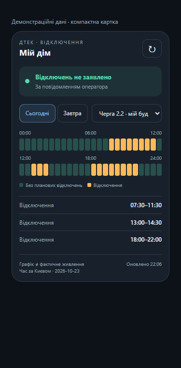

# DTEK Outage Card

Компактна картка відключень для Home Assistant та інтеграції [DTEK Monitor](https://github.com/groove-max/ha-dtek-monitor).

Статус оператора, ваша черга, графік на сьогодні/завтра та інтервали відключень — в одній картці. Шкала доби складається з двох рядків і не потребує прокручування вбік.



## Можливості

- Автовибір групи будинку; інші черги можна обрати зі списку.
- Планові й можливі відключення, прогноз і години без даних мають різні позначення.
- Оновлення графіка вручну та автоматична перевірка щохвилини через API інтеграції.
- Орієнтовне відновлення за повідомленням ДТЕК.
- Час за Києвом, включно з переходом на літній/зимовий час.
- Адаптація до вузьких екранів і теми Home Assistant.
- Без Mushroom, card-mod, сторонніх бібліотек і кроку збірки.

Дані ДТЕК та графік **не є фізичним вимірюванням живлення вдома**. Аварійні відключення можуть відрізнятися від графіка. Відсутні дані не означають відсутність відключень.

## Вимоги

Home Assistant із налаштованою інтеграцією DTEK Monitor, яка підтримує WebSocket-команди `dtek_monitor/schedule_grid` та `dtek_monitor/schedule_refresh`. Картка перевірена проти контракту коду інтеграції від 23.10.2026; сумісність із давнішими випусками не гарантується. Потрібен сучасний браузер. Окремий вхід до особистого кабінету ДТЕК не потрібний для графіка будинку.

## Встановлення через HACS

Після публікації цього репозиторію:

1. У HACS відкрийте меню → **Власні репозиторії / Custom repositories**.
2. Вставте URL цього репозиторію та виберіть категорію **Dashboard** (внутрішня назва HACS — `plugin`).
3. Знайдіть **DTEK Outage Card**, завантажте та оновіть сторінку HA.
4. Перевірте ресурси панелі. Для репозиторію з назвою `dtek-outage-card` ресурс має шлях `/hacsfiles/dtek-outage-card/dtek-outage-card.js` і тип **Модуль JavaScript**. Якщо HACS його не додав, додайте вручну.

Залиште лише одне підключення цієї картки: HACS або ручне. Налаштування `hacs.json` підготовлено за [документацією HACS](https://hacs.dev/docs/publish/plugin/); перевірка реального репозиторію відбудеться після публікації.

## Ручне встановлення

1. Завантажте `dtek-outage-card.js` із цього репозиторію.
2. Покладіть файл у **`/config/www/dtek-outage-card.js`** активної конфігурації Home Assistant. `configuration.yaml` має бути в `/config`, а не в додатковій вкладеній папці `config`.
3. Якщо `www` створено вперше, перезапустіть HA.
4. Налаштування → Панелі керування → ⋮ → Ресурси → додайте URL `/local/dtek-outage-card.js?v=1.0.0`, тип **Модуль JavaScript**. У профілі може знадобитися розширений режим.
5. Натисніть Ctrl+Shift+R. Відкриття `/local/dtek-outage-card.js?v=1.0.0` у браузері має показати код, а не 404.

Для ресурсів, які керуються YAML, додайте до наявного `lovelace.resources`:

```yaml
- url: /local/dtek-outage-card.js?v=1.0.0
  type: module
```

## Додавання картки

Редагувати панель → Додати картку → Вручну:

```yaml
type: custom:dtek-outage-card
title: Мій дім
entity: binary_sensor.YOUR_PREFIX_power
status_entity: sensor.YOUR_PREFIX_schedule_status
updated_entity: sensor.YOUR_PREFIX_dtek_last_update
grid_options:
  columns: full
```

Замініть **повні ID** на сутності свого пристрою. Старі імена можуть відрізнятися. `status_entity` — сенсор доступності графіка, а не стан відключення чи з'єднання. Готовий шаблон: [examples/dashboard.yaml](examples/dashboard.yaml).

| Параметр | Обов'язковий | Значення |
| --- | --- | --- |
| `type` | Так | `custom:dtek-outage-card` |
| `entity` | Так | `binary_sensor` електропостачання ДТЕК |
| `status_entity` | Так | Сенсор доступності графіка |
| `updated_entity` | Ні | Сенсор останнього оновлення ДТЕК |
| `title` | Ні | Заголовок; стандартно «Мій дім» |
| `group` | Ні | Початкова черга, наприклад `GPV2.2`; інакше група будинку |

Не вкладайте картку в `horizontal-stack`: він звужує доступне місце. У панелі «Розділи» `grid_options` задає всю ширину секції. Для окремого подання на всю ширину використовуйте тип подання **«Панель»** з однією карткою.

## Як знайти ID

Інструменти розробника → Шаблон:

```jinja2

{{ entity_id }} — {{ state_attr(entity_id, 'friendly_name') }} — {{ states(entity_id) }}

```

## Усунення помилок

**Custom element not found:** перевірте наявність JS у `/config/www`, URL ресурсу та тип «Модуль JavaScript». Збільште параметр версії URL після оновлення файлу й перезавантажте панель. Ресурс реєструє елемент `dtek-outage-card`, а не старий `dtek-glow-card`.

**Графік недоступний:** перевірте `status_entity`, стан інтеграції та підтримку її WebSocket API. Невдалий запит очищає попередню сітку, щоб вона не виглядала актуальною.

**Немає графіка на завтра:** це може бути відсутність публікації ДТЕК. Сірі смуги не означають день без відключень.

**Список інтервалів прокручується:** для великої кількості інтервалів висота списку обмежена 155 px. Уся картка не розтягується на кілька екранів.

## Демо й перевірки

Відкрийте [demo/index.html](demo/index.html) локально разом із файлами репозиторію. Дані вигадані; сервер HA не потрібний.

```sh
npm ci
npx playwright install chromium
npm test
```

Тести перевіряють групу будинку, інтервали, вузькі екрани, відсутні дані на завтра й очищення графіка після помилки API. На демо перевірено ширини 320, 375 та 1200 px. Живе підключення до чужого HA та встановлення HACS у цьому репозиторії локальними тестами не перевіряються.

## Публікація на GitHub

Створіть порожній репозиторій **`dtek-outage-card`** і завантажте весь вміст цієї папки, включно з `.github`. JS і `hacs.json` мають лежати в корені. Покроково: [PUBLISHING.uk.md](PUBLISHING.uk.md).

## Ліцензія

MIT — для коду цієї картки. DTEK Monitor є окремим проєктом із власною ліцензією; його вихідний код не включено до цього пакета. Це незалежна картка спільноти, не продукт ДТЕК.
